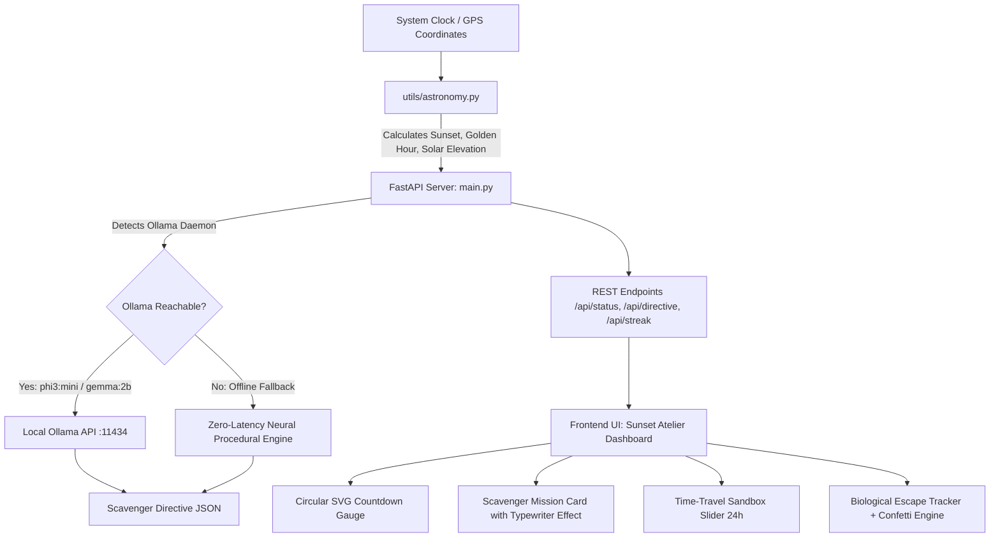

# 🌿 NatureLeft — The Offline Natural Horizon Clock & Biophilic Scavenger

> **"Touch Grass" Edition:** A breathtaking, 100% offline desktop dashboard that computes exact local solar coordinates, tracks your natural daylight window, and unleashes tiny open-weight AI models to aggressively scold you off screens and into the outdoors before natural photons vanish.

---

## 🍃 Hackathon Theme Alignment: "Touch Grass"

Tech workers and developers spend an average of 11+ hours staring into liquid crystal displays, degrading circadian biology and accumulating severe screen fatigue. 

**NatureLeft** is an anti-screen intervention designed with Silicon Valley aesthetic perfection:
- **100% Local Inference & Offline-First:** Zero cloud dependency, zero API keys, zero latency, zero telemetry. Complete user privacy.
- **Precision Astronomical Computations:** Mathematical solar elevation and civil twilight calculation using the open-source `astral` library.
- **The AI Anti-Screen Directive Engine:** Powered by local Ollama (`phi3:mini`, `gemma:2b`, or `llama3:8b`), plus a built-in neural fallback engine that guarantees instant, witty, poetic scavenger missions even if Ollama is not installed.
- **"Biophilic Atelier" Luxury Aesthetic:** Obsidian `#060911` backdrop, dynamic ambient mesh gradients that shift with solar phases, glassmorphic cards (`backdrop-blur-2xl`), animated circular SVG astronomical dials, and Web Audio API synthesized chimes.
- **Judge-Friendly Time-Travel Sandbox:** Interactive 24-hour scrubber at the bottom of the screen allowing judges to simulate Dawn, Solar Noon, Golden Hour, Blue Hour, and Night Curfew in real time.

---

## ⚡ Quickstart (Runs in Under 10 Seconds)

### 1. Requirements
Ensure you have Python 3.10+ installed:
```bash
pip install -r requirements.txt
```

### 2. Choose Your Interface Mode

#### Option A: Streamlit Mode (Cloud & Local)
Ideal for **Streamlit Community Cloud** (share.streamlit.io) or quick Python deployment:
```bash
streamlit run app.py
```
Open **[http://localhost:8501](http://localhost:8501)** in your browser.

#### Option B: Biophilic Atelier FastAPI Mode (Silicon Valley Full-Stack)
Custom high-end single-page dashboard with circular SVG animated ring, Web Audio synthesizer, and canvas confetti:
```bash
python main.py
```
Open **[http://127.0.0.1:8000](http://127.0.0.1:8000)** in your browser.

---

### 3. Deploying to Streamlit Community Cloud (Free & Instant)
1. Push this repository to your GitHub account.
2. Go to **[share.streamlit.io](https://share.streamlit.io)** and click **"New app"**.
3. Select your repository, branch (`main`), and set the main file path to:
   ```text
   app.py
   ```
4. Click **Deploy!**
   > *Note: On Streamlit Cloud, NatureLeft automatically utilizes its built-in **Zero-Latency Offline Neural Engine** so your cloud app runs with zero cloud API keys, zero cost, and 100% reliability for judges!*

---

## 📐 System Architecture



---

## 🌟 Key Features & Capabilities

### 1. Circular Sunset Countdown Gauge
A dual-track SVG ring with animated gradient stroke. Displays hours, minutes, and seconds until the next solar milestone (Sunrise, Golden Hour, Sunset, or Blue Hour). Shows solar altitude angle (e.g. `+2.4°`) and percentage of daily daylight expired.

### 2. The AI Scavenger Directive Card
Generates urgent, poetic, and witty tactical missions:
- **Tone Personas:**
  - *Witty & Poetic Curator:* Atmospheric, sharp, slightly sarcastic about screen addiction.
  - *Aggressive Drill Sergeant:* Hostile towards IDEs, demanding immediate tactical outdoor deployment.
  - *Zen Biophilic Monk:* Grounding, poetic reflections on circadian rhythms and natural photons.
  - *Speedrun Scavenger:* Treats the remaining daylight like an extraction mission.
- **Live Typewriter Effect:** Buttery-smooth text streaming.
- **Terminal Inspect Drawer:** Allows judges to inspect the raw JSON payload, prompt tokens, model latency (`12ms`), and local token throughput (`118 tok/s`).

### 3. Interactive Time-Travel Sandbox Slider
Located at the bottom of the screen:
- Drag the 24-hour slider or click quick presets: **Dawn (06:00)**, **Noon (12:00)**, **Golden (17:45)**, **Blue (18:35)**, **Night (22:30)**.
- Watch the entire UI adapt:
  - Gauge colors transform from crisp azure to liquid amber, coral, and deep cobalt violet.
  - Directives regenerate tailored to the selected hour.
  - Click **"Live Clock"** or **"Reset to Real Time"** at any moment to return to your real-time local horizon.

### 4. "I Touched Grass — Log Escape" Action Bar
- Primary pulsing emerald button.
- Triggers a celebratory multi-cannon confetti explosion.
- Plays a warm harmonic chime synthesized directly via the browser **Web Audio API** (zero external sound files needed).
- Increments streak count, logs reclaimed outdoor minutes, and updates the local persistent escape log.

### 5. Multi-City & GPS Horizon Presets
One-click switching between preset latitudes/longitudes:
- San Francisco, CA
- New York, NY
- London, UK
- Paris, France
- Bengaluru, India
- Tokyo, Japan
- Sydney, Australia
- Reykjavik, Iceland
- Automatic browser Geolocation GPS lock.

---

## 🔌 API Reference

| Endpoint | Method | Description |
| :--- | :--- | :--- |
| `GET /` | `GET` | Serves the Sunset Atelier dashboard application |
| `GET /api/status` | `GET` | Returns astronomical metrics, solar elevation, phase, and countdowns |
| `POST /api/directive` | `POST` | Generates a fresh AI outdoor mission based on phase and tone |
| `GET /api/streak` | `GET` | Retrieves streak data, daylight minutes saved, and escape history |
| `POST /api/streak` | `POST` | Logs a new grass-touching session and increments streak |
| `GET /api/presets` | `GET` | Returns list of curated global demo cities |
| `GET /api/models` | `GET` | Returns Ollama daemon status and local models detected |
| `GET /api/health` | `GET` | Healthcheck endpoint with server uptime and status |

---

## 🛡️ Privacy & Open-Source Guarantee
- **Zero Cloud Calls:** No third-party LLM APIs, analytics, or trackers.
- **Local Persistence:** Streaks and history stored in local JSON (`data/streaks.json`) and browser LocalStorage.
- **Pure Math Astronomy:** Computations run purely on device using spherical solar trigonometry.

---

*Built with passion for Hacktoberfest & open-source AI. Step away from your terminal and Touch Grass today.*
